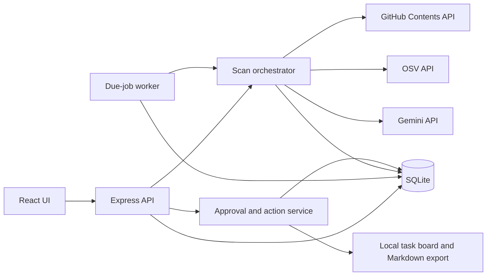

# PatchPilot — AI Dependency Security Analyst

**Assignment proposal and implementation guide**  
**Date:** 12 October 2026  
**Status:** Local implementation authorized by the user on 12 October 2026. External review/email remains pending.

**Current scope:** Build locally now, with Gemini as the only credential. Public GitHub reads and OSV supply the two data integrations. Approved tasks are saved in SQLite and exported as Markdown; no GitHub writes, deployment, or email sending. This scope supersedes the initial external-approval-first sequence at the user's direction.  
**Delivery target:** Today, subject to review turnaround and credential availability.

## 1. Role, industry, and problem

**Role:** Dependency security analyst at a small B2B SaaS company using Node.js.

Small engineering teams must turn dependency vulnerability alerts into practical remediation work. The repetitive work includes identifying installed versions, collecting advisory evidence, distinguishing runtime and development dependencies, preparing tickets, and following up. The proposed agent automates this operational loop while the engineer retains responsibility for code changes and risk acceptance.

**Product promise:** Turn an npm dependency inventory into a prioritized, evidence-linked remediation queue and approved local remediation tasks, then monitor for changes automatically.

The buyer hypothesis is an engineering lead without a dedicated application security analyst. The potential value is less manual research and ticket preparation. Willingness to pay is unvalidated; the demonstration will measure workflow completion and elapsed time, not invent savings or customer demand.

This is intentionally a narrow slice of the analyst role. It does not replace a security team, prove exploitability, or certify that software is secure.

## 2. Research and choice rationale

NIST's SSDF describes ongoing vulnerability identification, assessment, prioritization, and remediation. Its DevSecOps implementation guidance explicitly connects public vulnerability monitoring to risk analysis and issue tracking. These responsibilities motivate the workflow below. [1][2]

OSV supports queries for exact package versions and returns advisory records. That makes it appropriate for identifying published dependency matches without asking a language model to invent vulnerabilities. [3][4]

GitHub provides repository-content and issue-management APIs. The local edition consumes public inventories through the Contents API and exports approved tasks for manual import into an issue tracker. [5][6]

**Existing alternative:** Dependabot already supplies vulnerability alerts and related remediation capabilities. PatchPilot must therefore demonstrate contextual explanation, a consolidated review queue, user-approved local task creation, and an observable follow-up loop. The proposal does not claim novel scanning technology or superiority to Dependabot. [7]

| Candidate | Strength | Same-day constraint | Decision |
| --- | --- | --- | --- |
| SaaS dependency security analyst | Exact-version evidence, accessible APIs, verifiable task approval/export | Must add useful workflow beyond existing scanners | Selected |
| Food retailer recall coordinator | Clear inventory-to-recall operational value | Reliable product matching and domain validation need more time | Deferred |
| Outdoor-event operations coordinator | Weather-triggered planning and reminders | Strong demo depends on realistic operational thresholds and communications setup | Deferred |

## 3. Responsibility breakdown and priority

Priorities reflect implementation judgment, not measured customer research. P0 is required for the core demo; P1 follows only after P0 works.

| Responsibility | Input and dependency | Agent output | Priority and value |
| --- | --- | --- | --- |
| Inventory dependencies | Supported npm lockfile | Exact package/version inventory with coverage count | P0: reliable foundation |
| Monitor vulnerability sources | Inventory → OSV queries | Advisory matches with sources and timestamps | P0: eliminates repeated lookup |
| Investigate and triage | Advisory + declared application context | Evidence summary, uncertainty, suggested next step | P0: useful AI reasoning |
| Prepare remediation work | Findings → structured draft | Editable local task preview | P0: turns data into action |
| Assign work to engineering | Approved preview | Persisted local task, Markdown export, and audit event | P0: verifiable external action |
| Track new findings | Saved inventory + next-run time | Background scan and new-finding notification | P1: proactive automation |
| Follow up on remediation | Local task + repeat scan | Task state and latest dependency-match state | P1: closes the monitoring loop |
| Patch, test, and release fixes | Source changes and engineering judgment | Outside MVP | Excluded: too broad for one day |

**Workflow dependency:** inventory → vulnerability lookup → evidence normalization → AI brief → review → local task approval/export → monitoring.

## 4. Functional requirements

### F1. Add an inventory

- Import `package-lock.json` version 1, 2 or 3 from a public GitHub repository, specifying owner, repository, branch/ref, and lockfile path; alternatively upload a lockfile.
- GitHub import records the resolved commit SHA to make the scan reproducible.
- Support npm packages with exact installed versions, including nested entries. Deduplicate API queries by ecosystem/name/version while preserving inventory locations.
- Derive scoped package names correctly. Skip links, workspaces without resolved versions, and unsupported sources with visible reasons.
- Reject unsupported lockfile formats and oversized inputs rather than silently guessing. Proposed caps: 1 MiB input and 2,000 unique package/version pairs per scan.
- Provide an explicitly labeled synthetic vulnerable inventory for the demo. Never install or execute its dependencies.

### F2. Scan and explain coverage

- Query OSV by exact package/version through `/v1/query`, with four concurrent requests and pagination. This endpoint returns full advisory records, avoiding a second detail fetch. Cache results for 15 minutes.
- Display scanned, skipped, and failed package counts. Partial results must never appear as a successful clean scan.
- Retain IDs, aliases, affected package data, advisory references, withdrawn status, and retrieval time. Ignore withdrawn records as active findings.
- Group equivalent advisories using aliases without merging unrelated package/version occurrences.
- Label an OSV match as a published affected-version match, not proof that the application is exploitable.

### F3. Produce a grounded AI brief

- Ask Gemini to produce structured JSON containing an explanation, evidence references, recommended investigation, remediation considerations, and unresolved questions.
- Supply only selected advisory fields, dependency metadata, and user-entered non-sensitive application context. Do not send source code or tokens.
- Validate the response schema and require references to supplied evidence IDs. Reject unknown IDs and unsupported proposed version numbers.
- Show advisory severity separately from workflow priority. Missing severity remains “unknown”; do not invent a CVSS score.
- Initial deterministic queue ordering: published severity (critical, high, moderate, low, unknown), runtime before development, then stable advisory ID. Unknown severity also gets a visible “needs review” flag.
- AI can explain context but cannot silently suppress findings or override source facts. Suggested fixed versions are advisory evidence requiring compatibility checks, not guaranteed safe upgrades.
- If Gemini is missing, rate-limited, or invalid, keep the evidence view available and explicitly mark the brief unavailable. A template fallback is not presented as a successful AI run.

### F4. Take an approved local action

- Generate an editable task preview with package/version, evidence URLs, investigation steps, and verification checklist.
- User reviews the exact title/body and clicks “Approve & save task.” The backend validates explicit approval and the scan/finding relationship.
- Persist the approved content in SQLite with a unique inventory/finding identity. Repeated approval returns the existing task without creating duplicates.
- Export a task as a Markdown download for an issue tracker; allow marking it done or reopening it locally.
- Maintain activity events for approvals and status changes. Marking a task done does not establish that the vulnerability is fixed.
- No external issue creation or credentials beyond Gemini are included in this local version.

### F5. Run proactive checks

- User opts an inventory into monitoring and sees the next scheduled run.
- A backend worker checks due jobs every minute and rescans monitored inventories daily while the process is running.
- Persist next-run time and scan history in SQLite; after restart, execute one overdue scan rather than replaying every missed interval.
- For repository imports, fetch the latest configured ref and record its new SHA. Uploaded inventories are rechecked against new advisories but cannot detect code changes.
- Create in-app notifications for newly discovered findings; do not create external issues without review.
- Provide “Run due checks now” to demonstrate the same worker logic without waiting a day. Label manual triggers accurately.
- Compare findings against the previous complete scan. Count findings no longer detected only when current coverage is complete. Local task status remains independent of scan evidence.

## 5. User interface

Build a responsive React workspace with four focused views:

1. **Overview:** latest scan status, coverage, open findings, pending approvals, integration status, next monitor run.
2. **Inventory and scan:** repository form/upload, context fields, progress, supported-format guidance, clearly marked demo inventory.
3. **Triage queue:** filters, package/version, source severity, runtime/development classification, finding detail, AI brief, evidence links.
4. **Action review and activity:** editable task preview, explicit approval, saved task and export, scan/action history, monitor controls.

Use keyboard-accessible controls, visible loading/error/empty states, and text labels in addition to severity colors. Keep secrets out of the browser. Clearly distinguish live API results, synthetic input, missing integrations, and failed operations.

## 6. Architecture and technical approach

**Stack:** React + TypeScript + Vite frontend; Node.js + TypeScript + Express backend; SQLite persistence; runtime schema validation; native HTTP clients; Gemini Developer API. Use a supported Node LTS runtime for reproducibility; check dependency compatibility before selecting exact versions.

The scan orchestrator follows an explicit state machine: `queued → fetching → scanning → summarizing → completed`, with distinct `partial` and `failed` terminal states. When a Gemini key is configured, the highest-priority finding receives one automatic brief per scan; other briefs are user-triggered and successful results are reused. Persist progress so the UI can poll and recovered jobs can be explained. The model reasons over collected evidence; deterministic backend code controls providers, storage, scheduling, and writes.

**Data model:** SQLite stores typed JSON documents in four tables: inventories, scans, tickets, and activity. Inventories contain dependency occurrences and monitor schedules; scans contain advisory evidence, findings, and AI briefs. Store provider timestamps and resolved repository SHA. Stable finding keys identify package/version/advisory matches, and a SQLite unique index enforces the inventory/finding task identity.

**API surface:** inventory creation/listing; scan enqueue/status/results; finding brief generation; action preview/approval; action status; monitoring settings; activity; provider readiness. Mutating requests require the local application's session and origin checks. Validate request bodies server-side.

**Proposed module boundaries:** `server/inventory`, `server/scans`, `server/providers`, `server/actions`, `server/monitoring`, `server/storage`, `shared/contracts`, and `client/components`. Keep every authored code file at 300 lines or fewer; split by responsibility.

**Deployment scope:** single-user localhost application, bound to loopback. Serve the built frontend from the backend. No cloud billing, public exposure, or multi-user authentication is needed for the local demonstration. Public hosting is a separate scope decision requiring appropriate authentication and durable storage.

## 7. Integrations and free-access validation

Documentation checked on 12 October 2026. Documentation availability is not a successful live integration test.

| Integration | Purpose | Free access and limits | Setup |
| --- | --- | --- | --- |
| OSV API | Exact-version vulnerability evidence | Public API; documentation currently states no API rate limits. Apply our own concurrency and request caps regardless. [3][4] | No API key shown in documented requests |
| GitHub REST API | Read public lockfiles at recorded commits | Standard limits are 60 requests/hour unauthenticated and 5,000/hour for authenticated users; secondary limits also apply. No paid GitHub feature is required for public repository reads. [5][6][8] | No token needed for public reads; no GitHub write operations |
| Gemini Developer API | Evidence-grounded analysis and issue drafting | Gemini 2.5 Flash is listed with free-tier input/output. Active quota varies by project/model and must be checked in AI Studio; do not assume the assignment's example quotas. [9][10] | User creates an eligible free-tier API key and stores it in local environment configuration |

OSV and GitHub satisfy the two non-LLM integration requirement; Gemini is additional. Cache unchanged advisory records, bound concurrency to four requests, use timeouts, and honor rate-limit responses. The demo should stay small rather than treat free quotas as unlimited capacity.

**Cloud correction:** Google states that Google Cloud services, including Free Tier services, require an active linked billing account. Therefore this design does not rely on the assignment's claim that Cloud Run/Cloud Scheduler can be used without billing. Local background scheduling preserves proactive behavior while the application is running. [11]

**Data consideration:** Gemini's pricing page marks free-tier data as used to improve products. Use public advisories, synthetic/public inventories, and non-sensitive demo context. Do not send private source code or confidential business details. [9]

## 8. Reliability and trust boundaries

- Treat advisory text, repository files, and model output as untrusted data; never execute instructions embedded in them.
- Allow network calls only to the configured GitHub, OSV, and Gemini API hosts. Repository input is a validated owner/repository/ref/path, not an arbitrary fetch URL.
- Keep credentials server-side, redact provider errors, exclude local secrets/database from the submitted source archive, and commit only an environment example.
- A single-process in-flight registry prevents overlapping scans and monitor jobs. A SQLite unique index prevents duplicate approved tasks. Running multiple processes against one database is unsupported.
- Retry transient reads with a bounded policy. Preserve failed work with a visible retry option and explanatory status.
- A process crash, lack of internet, disabled issues, exhausted quota, or missing credentials must appear in the UI rather than being represented as success.
- No automatic dependency installation, patches, merges, releases, or risk acceptance.

## 9. Step-by-step delivery plan

These are original planning estimates, not measured execution times or a promise about access and provider response times. Work sequentially and preserve the core demo before optional additions.

| Step | Deliverable and work | Verification | Estimate |
| --- | --- | --- | --- |
| 0 | Follow the user's local-build authorization; configure Gemini when a key is available | Local-only scope recorded; key never logged | User authorized; Gemini configured and live brief verified |
| 1 | Establish shared contracts, SQLite schema, backend and React shell; implement inventory parsing | Supported lockfile parses; nested/scoped entries correct; malformed/oversized files rejected | 35–50 min |
| 2 | Implement GitHub inventory fetch, OSV scan orchestration, evidence storage and queue UI | Live reads recorded; known affected inventory yields matches; partial/provider failures visible | 50–70 min |
| 3 | Implement Gemini structured briefs and finding detail UI | Real model response grounded to supplied IDs; malformed output and unavailable key handled | 35–50 min |
| 4 | Implement editable task preview, approval, deduplicated local task approval/export and audit history | One approved action creates one local task; repeated click does not duplicate it | 40–60 min |
| 5 | Implement persisted monitor schedule, worker, notifications and scan comparison | Due task runs; overlap/restart behavior checked; UI records manual versus scheduled trigger | 25–40 min |
| 6 | Run integration checks and existing-browser UI walkthrough; refine responsive/error states | End-to-end evidence, build/type checks, file-length audit, no exposed secrets | 35–50 min |
| 7 | Complete README and recording walkthrough; retain local source for later submission | Documented setup and walkthrough; recording and submission explicitly pending | 30–45 min |

Estimated implementation and handoff effort: **4 hours 10 minutes–6 hours 5 minutes**, excluding access delays. If time becomes constrained, finish Steps 1–4 and 6–7 before P1 monitoring; explicitly disclose the reduced proactive scope. Do not substitute mock-only output for live integration evidence.

**Verification approach:** exercise parser boundaries, partial scans, grounded AI output, action duplication/timeouts, and schedule persistence. The user approved retaining the regression-test suite; temporary verification scripts are removed afterward. Browser verification must attach to the user's existing approved session, never silently launch a new profile.

## 10. Acceptance criteria and submission evidence

- [ ] A supported inventory can be imported through the UI and persists after restart.
- [x] A real GitHub read and real OSV query succeed, with the result visible in the UI.
- [x] A real Gemini call produces an evidence-linked brief with model provenance and uncertainty; HTTP 200 and persisted dashboard data verified using Gemini 3.1 Flash Lite.
- [x] A reviewed task is saved locally and downloads as Markdown.
- [x] Repeating approval does not create a duplicate task.
- [x] Missing credentials, provider errors, and partial results are visibly distinct from success.
- [x] Monitoring worker logic is covered by regression tests; enable/disable controls are verified in the browser. An unattended next-day run is not claimed.
- [x] Desktop and narrow layouts checked in the existing Chrome session; navigation and keyboard dialog opening/closing verified. A full accessibility audit is outside this local verification.
- [x] Build, type checks, behavioral verification, and code-file line limits pass.
- [x] README includes setup, environment variables, limitations, API costs/quotas, architecture, and verification actually performed.
- [ ] Source package excludes secrets, installed dependencies, runtime databases, and temporary artifacts.
- [ ] Recording explains the problem, design, live workflow, and both frontend and backend code.
- [ ] Final submission includes source, this design, documentation, and accessible video.

**Suggested 6–8 minute recording:** problem and role (45 seconds); research and architecture (60 seconds); live inventory → scan → AI brief (2 minutes); approve task and demonstrate Markdown export (1 minute); demonstrate monitoring and an error state (1 minute); frontend/backend code walkthrough and limitations (1–2 minutes). Rehearse once; do not display API keys.

## 11. Remaining dependencies and handoff boundaries

1. Working Gemini free-tier access. The user creates the API key and adds it to `.env`; the app reads it without a restart. A configured key is not proof of a successful live model response.
2. This is a local demo. No deployment, external issue, proposal email, or final submission is authorized by the current build instruction.
3. The original assignment asks for external design review. The user explicitly requested building locally first; Kidus's approval has not been obtained or represented as obtained.
4. Recording and final submission remain a later step. The README includes a demo/code walkthrough outline; a narrated recording is not claimed complete.
5. Public-repository imports are limited to supported lockfiles and unauthenticated GitHub quota. Private repositories, Yarn/pnpm, more than 2,000 unique versions, automated patching, and multi-user hosting are out of scope.
6. Uploaded inventories are snapshots. Upload a new inventory after changing the lockfile. Monitoring an upload detects newly published advisories, not changes to the user's code.

## 12. Implementation decisions

- **Local-first:** User explicitly authorized implementation before external review, and restricted credentials to Gemini. Tasks therefore persist locally instead of being posted to GitHub.
- **OSV query endpoint:** Four concurrent per-package queries return complete evidence directly. Batching would require additional record-fetch logic; the 2,000-package cap and cache bound the local workload.
- **Grounded AI:** Gemini explains collected evidence and drafts next steps; deterministic code controls matching, severity ordering, schedules, persistence, and approved writes.
- **SQLite:** A single process owns the local worker and database. Restart marks interrupted scans failed and performs one due monitor check rather than replaying every missed day.
- **Reproducibility:** Installed dependencies are pinned by the generated package lock. All authored code is formatted and split into files of at most 300 lines. Runtime databases, credentials, and browser artifacts are excluded from source submission.

## 13. Sources

1. NIST SSDF v1.1: https://www.nist.gov/publications/secure-software-development-framework-ssdf-version-11-recommendations-mitigating-risk
2. NIST DevSecOps SSDF analysis, RV.1 and RV.2: https://pages.nist.gov/nccoe-devsecops/appendix-c.html
3. OSV API and limits: https://google.github.io/osv.dev/api/
4. OSV batch queries: https://google.github.io/osv.dev/post-v1-querybatch/
5. GitHub repository contents API: https://docs.github.com/en/rest/repos/contents
6. GitHub issues API: https://docs.github.com/en/rest/issues/issues
7. GitHub Dependabot alerts: https://docs.github.com/en/code-security/concepts/supply-chain-security/dependabot-alerts
8. GitHub REST rate limits: https://docs.github.com/en/rest/using-the-rest-api/rate-limits-for-the-rest-api
9. Gemini API pricing: https://ai.google.dev/gemini-api/docs/pricing
10. Gemini API rate limits: https://ai.google.dev/gemini-api/docs/rate-limits
11. Google Cloud billing requirement: https://docs.cloud.google.com/docs/get-started/learn-about-billing
